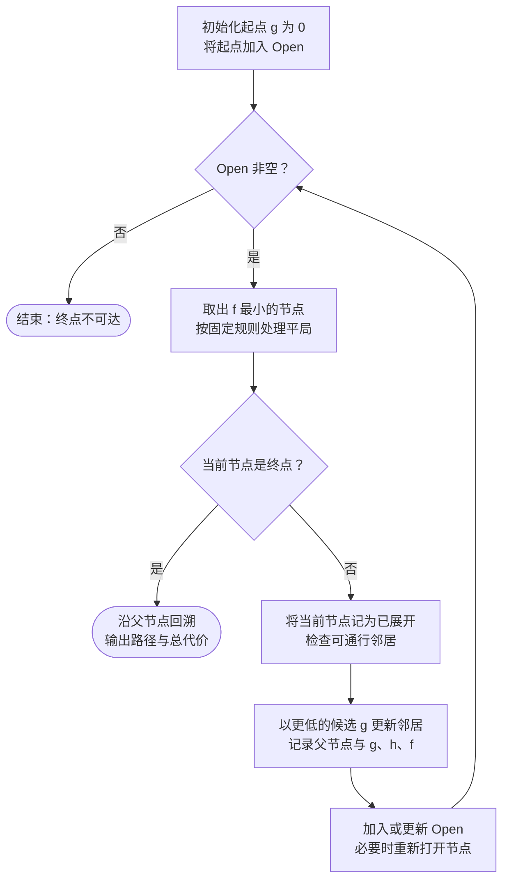
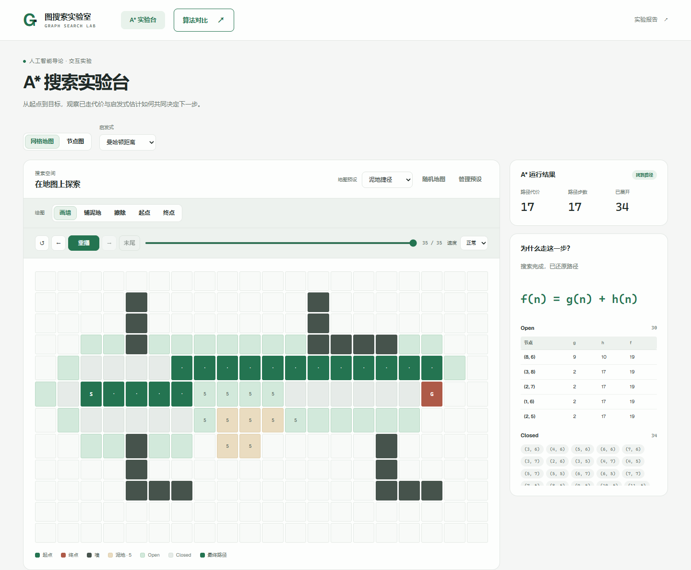
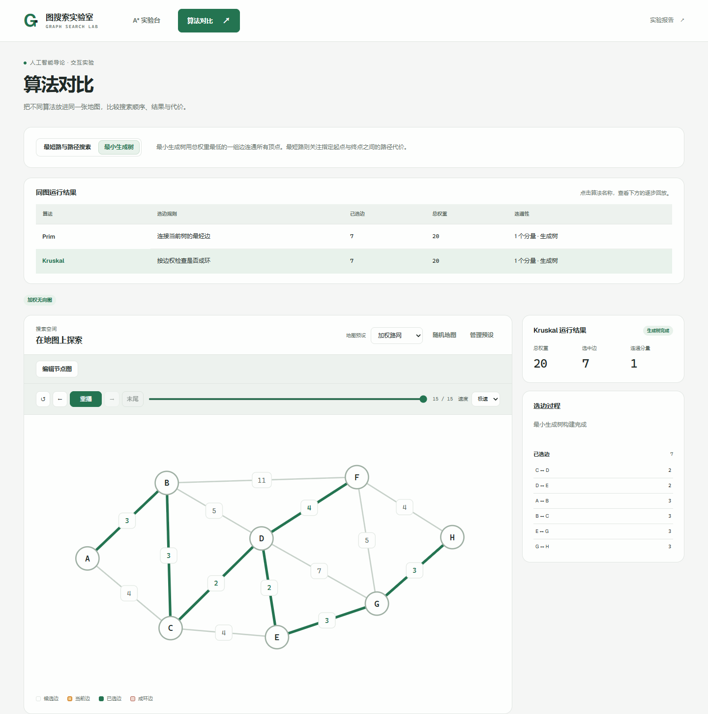
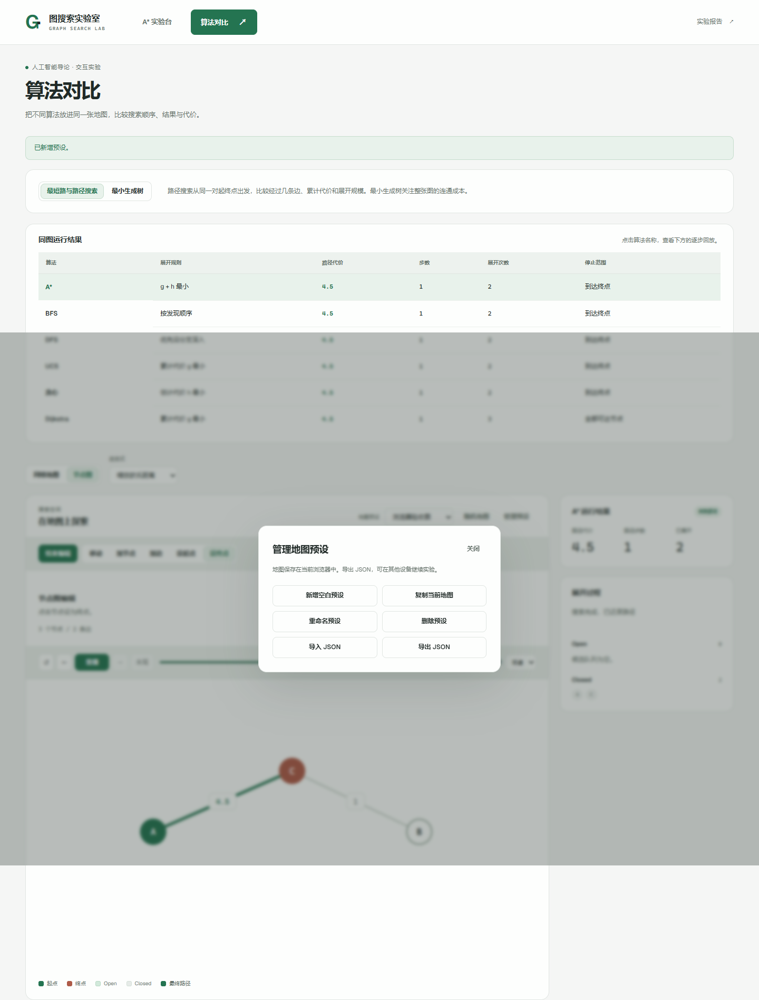
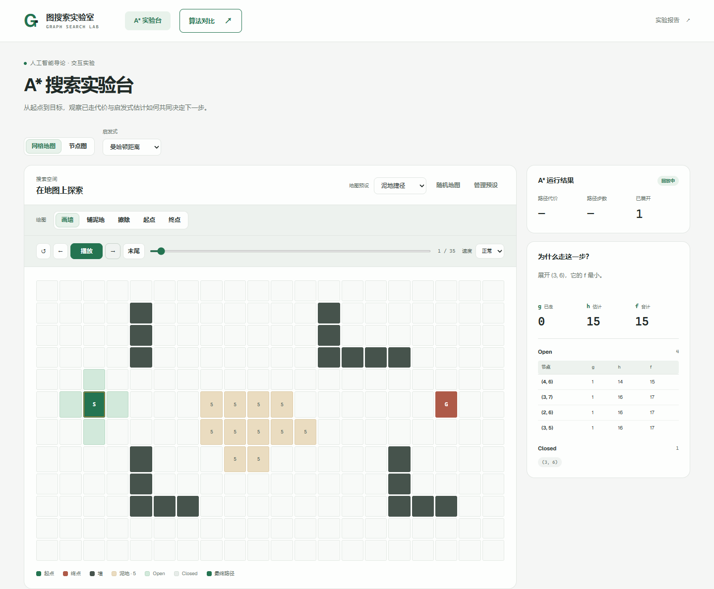
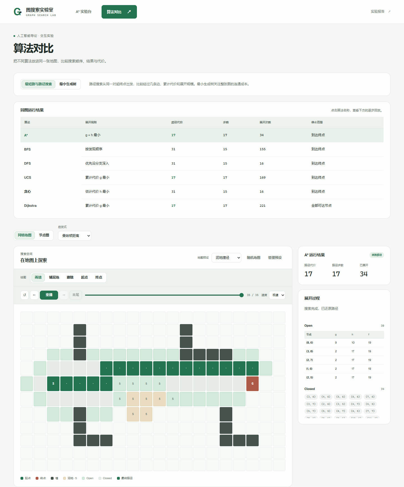

# 图搜索算法可视化实验报告

《人工智能导论》课程作业 · 2026 年 11 月 24 日

## 1. 实验目的与问题

本项目将图搜索算法做成可编辑、可回放的浏览器实验台。默认进入 A* 网格实验，在同一张地图上观察候选节点如何进入 Open、何时被展开、父节点如何更新，以及最终路径为什么避开或穿过泥地；进一步在算法对比中检验“步数少”“代价低”“展开少”之间的区别。

实验围绕三个问题展开：第一，A* 的启发式如何在保持路径最优的条件下减少搜索？第二，BFS、DFS、UCS、Dijkstra 与贪心最佳优先在相同地图上为何得到不同结果？第三，Prim、Kruskal 的最小生成树目标与两点间最短路有什么区别？

交互功能参考了[图搜索可视化器](https://relumeow.top/AIIntroduceCourse/search/index.html)所呈现的教学方向，项目中的界面、地图数据、算法实现和报告按本次课程需求独立组织。源码仓库为 [graph-search-playground](https://github.com/luxiaoyu7548/graph-search-playground)。报告中的数值来自本仓库算法对固定内置地图的直接运行，不采用参考网站的结果。

## 2. 地图模型与实验约定

### 2.1 两类地图

网格为 **20 列 × 12 行**，只允许上、下、左、右四方向移动，不允许斜向穿越。进入普通格的代价为 1，进入泥地格的代价为 5，墙不可通行。起点的初始代价为 0，因此路径总代价为沿途进入的各格代价之和。界面坐标以左上角为 `(1, 1)`，内部编号为零基行号 × 20 + 零基列号。

节点图为正权无向图。每条边可双向通行，路径代价为边权之和；画面中的几何距离只用于构造启发式，不能直接替代用户指定的边权。节点图允许不连通，用于观察不可达搜索与最小生成森林。编辑器限制为 2–24 个节点、最多 80 条边，边权范围为 0.01–10000；不允许自环和同一节点对的重复边。

| 内置预设 | 类型 | 设计目的 |
| --- | --- | --- |
| 泥地捷径 | 网格 | 直线更短但经过高代价格，比较步数与代价；检验过估计启发式 |
| U 形陷阱 | 网格 | 障碍迫使搜索绕行，观察局部接近终点为何可能误导 |
| 空地 | 网格 | 建立没有墙与泥地的基线 |
| 加权路网 | 节点图 | 对比正权最短路与最小生成树 |
| 两座岛 | 节点图 | 验证跨分量不可达及最小生成森林 |

随机地图用于课堂探索，不作为本报告固定实验的数据来源。若需保存某次随机结果，应先保存为自定义预设，再导出 JSON。

### 2.2 统计口径

路径代价衡量实际移动成本；路径步数为路径中的边数，在网格中也是移动次数。展开数统计算法实际取出并处理的节点次数，具体数值受邻居顺序和平局规则影响。生成树的指标为选中边数、总权重与连通分量数，不把树权重与一条路径的代价混成同一项排名。

Dijkstra 在本项目中运行至所有可达节点处理完毕，保留从起点到整个可达区域的距离；UCS 在终点被取出时结束，回答特定起终点的路径问题。两者都依靠当前最小的累计代价选点，因而在相同正权地图上到达终点的最优代价相同，但展开数可能不同。动画耗时由播放速度决定，不用作算法运行效率证据。

## 3. A* 搜索原理与回放

### 3.1 评价函数

A* 使用 `f(n) = g(n) + h(n)` 选择下一节点。`g(n)` 是目前发现的起点到节点 n 的最低代价，`h(n)` 是节点 n 到终点的估计代价，`f(n)` 则是经由 n 到终点的估计总代价。起点的 `g=0`，未发现节点的 `g` 视为无穷大。

Open 保存已发现、仍有待处理的节点；Closed 记录已展开节点。展开当前节点时，算法计算邻居的候选代价 `tentative_g = g(current) + cost(current, neighbor)`。只有候选代价更低时才更新邻居的 g 与父节点。发现更优路线时应允许重新处理该节点，避免将“曾展开过”误当作“任何情况下都不可能改善”。

下面给出与实现相对应的主流程。文字中的“更新邻居”包含逐个检查邻居、跳过墙和无效连接、比较候选代价并更新父节点。



### 3.2 启发式的选择与边界

启发式“可采纳”是指不高估真实剩余最优代价；“一致”是指每条可走边都满足 `h(u) ≤ c(u,v) + h(v)`。本项目边权均为正。使用一致启发式时，A* 取出终点即可确认最优；允许重新打开节点也便于展示后续路线改善。

| 地图与选项 | 计算方式 | 对最优性的意义 |
| --- | --- | --- |
| 网格：曼哈顿距离 | `abs(x-x_goal) + abs(y-y_goal)` | 四方向移动且每步至少代价 1，是可采纳且一致的下界 |
| 网格：欧氏距离 | 两坐标点的直线距离 | 不超过四方向移动的最低代价，是可采纳且一致的下界 |
| 网格或图：零启发式 | `h(n)=0` | A* 退化为依赖 g 的统一代价搜索 |
| 网格：5 倍曼哈顿 | `5 × 曼哈顿距离` | 可能高估普通格路线，不能保证最优，用作反例 |
| 节点图：缩放欧氏 | `h(n)=α × 欧氏距离(n,goal)` | 取所有非零长度边的 `α=min(边权/边长)`，防止几何距离高估边权 |

缩放欧氏启发式的依据是：对任一非零长度边都有 `α × 边长 ≤ 边权`，再由欧氏距离的三角不等式得到一致性。长度为零的边两端坐标相同，不影响这一不等式；若没有任何非零长度边，采用零启发式。节点位置移动或边权修改后，应重新计算缩放系数。



*图 1. 本项目 A* 实验台实际界面。通过暂停和单步操作，可将地图中的当前节点与状态解释逐项对应。*

### 3.3 建议的观察顺序

1. 选择“泥地捷径”和曼哈顿启发式，先单步观察起点的 `g=0` 与邻居的更新。
2. 暂停后检查 Open 中的节点，比较“g 较小但 h 较大”和“h 较小但已穿过泥地”的候选项。
3. 播放到结束，记录路径代价、步数和展开数，再拖动进度回到出现分歧的位置。
4. 在同一地图上改用零启发式、欧氏距离和 5 倍曼哈顿，比较终点路径与展开范围。

## 4. 八种算法及其目标

### 4.1 六种路径算法

| 算法 | 选点依据 | 本项目中能保证什么 | 主要观察点 |
| --- | --- | --- | --- |
| BFS 广度优先 | FIFO 队列，按层推进 | 有限图中找到最少边数路径；全等权时也为最低代价 | 忽略泥地额外成本，步数短可能代价高 |
| DFS 深度优先 | LIFO 栈，沿分支深入 | 有限图配合去重可判断可达性 | 结果依赖邻居顺序，通常不保证最短 |
| UCS 统一代价 | 当前最小 g | 正权条件下保证到终点的最低代价 | 取出终点后停止 |
| Dijkstra | 当前最小 g | 正权条件下求起点到全部可达节点的最低代价 | 终点到达后仍继续，适合查看全图距离 |
| 贪心最佳优先 | 当前最小 h | 不保证最低代价 | 只关注看起来接近终点，易受陷阱与泥地误导 |
| A* | 当前最小 g+h | 可采纳启发式配合正确更新可求最优；本项目保守选项均一致 | 在已付成本与剩余估计之间取得平衡 |

这些算法在当前有限地图上都用状态记录避免无限循环。比较时必须保持地图、起终点与启发式选项一致；DFS 或等优先级节点的不同展开顺序会改变展开数甚至所选的等价路径。

### 4.2 Prim 与 Kruskal

最小生成树要用尽可能低的总权重连接一个连通分量中的所有顶点，不要求某一对顶点之间沿树行走的距离最短。Prim 从当前分量的一点出发，反复选择连接“已加入节点”和“未加入节点”的最小权重边；Kruskal 将全图边按权重排序，依次选择不构成环的边，并使用并查集判断节点是否已连通。

不连通图不存在覆盖全图的单棵生成树，因此实现继续处理各分量，返回最小生成森林。若图有 V 个顶点、k 个连通分量，则最终森林包含 `V-k` 条边。两算法的最小总权重应相等，但同权边存在时，选中的具体边集未必唯一。



*图 2. 最小生成树实验界面。对“两座岛”应解释为两个分量各自生成树的森林，不能声称已经把两岛连接起来。*

## 5. 可编辑实验与数据保存

网格编辑支持绘制普通格、墙和泥地，并重新设置起终点。节点图支持增删节点、调整节点位置、增删边及修改边权；节点删除时关联边也应随之处理。地图编辑后需要重新生成轨迹，原轨迹对应的是编辑前的数据。

两类地图均可创建自定义预设，支持重命名、复制与删除。内置示例可复制后修改，自定义预设保存在当前浏览器的本地存储中；更换浏览器、设备或站点来源不会自动迁移。JSON 导出用于保存一份可移植的地图，导入则校验版本号、地图尺寸、地形类型、节点与边、起终点等条件。

导出的顶层结构为 `version`、`name`、`board`，当前版本号为 1。网格 board 包含 `type`、`cols`、`rows`、`cells`、`start`、`goal`；节点图 board 包含 `type`、`nodes`、`edges`、`start`、`goal`。JSON 保存地图和名称，不将某次动画播放进度当作地图的一部分。文件中的节点标识与边权是算法输入，修改后须重新导入或重新运行。



回放支持播放、暂停、向前与向后单步、进度定位和速度调整。向后定位是读取此前已记录的状态，而非把算法的松弛操作逆向执行。这样能在同一轮实验中反复检查关键状态，避免重新计算带来的观察混淆。

## 6. 固定地图实验与结果

本节使用内置预设的原始数据，不编辑起终点。直接调用与网页共用的算法模块取得数值，截图用于展示对应界面。数值复现不依赖动画播放速度。

### 6.1 同一张网格上的六种路径算法

打开「泥地捷径」，保持起点 (3, 6)、终点 (18, 6)，选择曼哈顿距离。在「算法对比」的「最短路与路径搜索」中读取结果。

| 算法 | 路径步数 | 路径总代价 | 展开次数 |
| --- | ---: | ---: | ---: |
| A* | 17 | 17 | 34 |
| BFS | 15 | 31 | 155 |
| DFS | 15 | 31 | 16 |
| UCS | 17 | 17 | 169 |
| 贪心最佳优先 | 15 | 31 | 16 |
| Dijkstra | 17 | 17 | 221 |

BFS 的 15 步路线经过四格泥地，总代价为 11 × 1 + 4 × 5 = 31。A* 与 UCS 找到 17 步普通地面路线，总代价降为 17。Dijkstra 在确认终点之后仍继续，221 次展开对应该图上全部可达节点，不能直接拿来衡量单终点任务的额外工作。

### 6.2 同一张网格上的四种启发式

回到 A* 首页，保留「泥地捷径」，依次更改启发式并跳到「末尾」。

| 启发式 | 路径步数 | 路径总代价 | 展开次数 |
| --- | ---: | ---: | ---: |
| 曼哈顿距离 | 17 | 17 | 34 |
| 欧氏距离 | 17 | 17 | 34 |
| 恒为 0 | 17 | 17 | 169 |
| 5 倍曼哈顿 | 15 | 31 | 16 |

恒零启发式与 UCS 的结果一致。5 倍曼哈顿将更多优先级给了横向靠近目标的节点，最终找到的路线虽然少走两步，却多付出 14 的代价。本例中两种正常几何启发式展开次数相同。



*图 3. 展开起点后，右侧列出本步的 g、h、f 和新候选节点。*

### 6.3 生成树、生成森林与两点路径

在「最小生成树」中分别载入「加权路网」和「两座岛」，选择 Prim 或 Kruskal 并回放到末尾。

| 地图 | 算法 | 选中边 | 总权重 | 分量 |
| --- | --- | ---: | ---: | ---: |
| 加权路网 | Prim | 7 | 20 | 1 |
| 加权路网 | Kruskal | 7 | 20 | 1 |
| 两座岛 | Prim | 5 | 11 | 2 |
| 两座岛 | Kruskal | 5 | 11 | 2 |

加权路网中，A 到 H 的最短路为 A → C → D → F → H，代价 14。相同节点在本例生成树中的唯一路线为 A → B → C → D → E → G → H，代价 16。两座岛中，路径搜索找不到 A 到 G 的路线，生成树算法仍能在每座岛内分别完成选边。

### 6.4 通过源码复现

在项目根目录启动 Node.js（执行 `node`），然后粘贴：

```js
const { builtins } = require('./presets.js');
const { search, mst } = require('./search.js');
const get = (id) => builtins.find((item) => item.id === id).board;
const sample = ({ result: { steps, cost, expanded } }) => ({ steps, cost, expanded });
for (const name of ['astar', 'bfs', 'dfs', 'ucs', 'greedy', 'dijkstra']) {
  console.log(name, sample(search(get('terrain'), name, 'manhattan')));
}
for (const h of ['manhattan', 'euclidean', 'zero', 'over']) {
  console.log(h, sample(search(get('terrain'), 'astar', h)));
}
for (const id of ['weighted', 'islands']) {
  for (const name of ['prim', 'kruskal']) console.log(id, name, mst(get(id), name).result);
}
```



*图 4. 路径算法对比界面。同图对比应先检查路径是否到达终点，再比较代价与展开数。*

## 7. 讨论与局限

A* 的优势取决于启发式提供了多少有效信息。零启发式虽然保守，但没有方向引导；曼哈顿距离利用网格移动模型提供下界；5 倍曼哈顿强化了方向偏好，却可能让算法过早接受高代价路径。评价算法时，应同时检查结果质量与搜索工作量，而不能只看动画最先结束的那一栏。

本报告使用少量刻意构造的教学地图，适合解释行为差异，不能据此给出所有地图上的统一速度排名。展开数也不是完整的运行时间：Open 的维护、排序、轨迹快照及界面绘制都有成本。当前实现面向小规模课堂可视化，节点图的几何布局服务于可读性，边权才定义真实移动代价。

不可达是正常实验结果。路径搜索应给出“不可达”，不将局部搜索路径包装成到终点的完整路线；生成树算法则应返回森林并报告分量。随机地图不保证连通，这有助于验证算法终止和边界处理。

本项目把算法计算与回放分离，将“选择节点—更新邻居—形成路径”的过程转成可检查的状态序列。课堂演示可先用 A* 解释 g、h、f，再用泥地说明最少步数与最低代价的差别，最后用“两座岛”说明路径与生成森林的问题边界。

## 8. 复现、源码与参考资料

本地可直接打开根目录的 `index.html`。也可在根目录运行 `python -m http.server 8000`，然后访问 `http://localhost:8000`；核心页面使用静态资源，计算在浏览器本地完成。浏览器本地保存依赖所在来源，因此 HTTP 访问和直接打开文件时应分别检查各自的预设存储。

| 文件 | 作用 |
| --- | --- |
| [index.html](../index.html) | 页面入口与交互结构 |
| [search.js](../search.js) | 路径算法、生成树算法及回放状态 |
| [presets.js](../presets.js) | 内置地图、随机地图及导入数据校验 |
| [tests/search.test.cjs](../tests/search.test.cjs) | 算法回归验证 |

使用 Node.js 时可在根目录执行 `node --test tests/search.test.cjs`。报告实验的精确调用见第 6 节。若将来修改邻居顺序、平局规则或内置地图，应重新运行并更新对应表格。

- 功能参考：[图搜索可视化器](https://relumeow.top/AIIntroduceCourse/search/index.html)。本报告仅声明功能方向参考，不将该站结果作为本项目实测证据。
- 项目源码：[luxiaoyu7548/graph-search-playground](https://github.com/luxiaoyu7548/graph-search-playground)。算法与地图定义以仓库当前源码为准。
- 流程图语法：[Mermaid Flowcharts](https://mermaid.js.org/syntax/flowchart.html)。本报告使用基本 flowchart 语法；支持 Mermaid 的 GitHub Markdown 页面可渲染，普通纯文本阅读器会显示源码。
- GitHub 图示说明：[Creating diagrams](https://docs.github.com/en/get-started/writing-on-github/working-with-advanced-formatting/creating-diagrams)。是否在特定客户端正常呈现，应以该客户端实际渲染为准。
